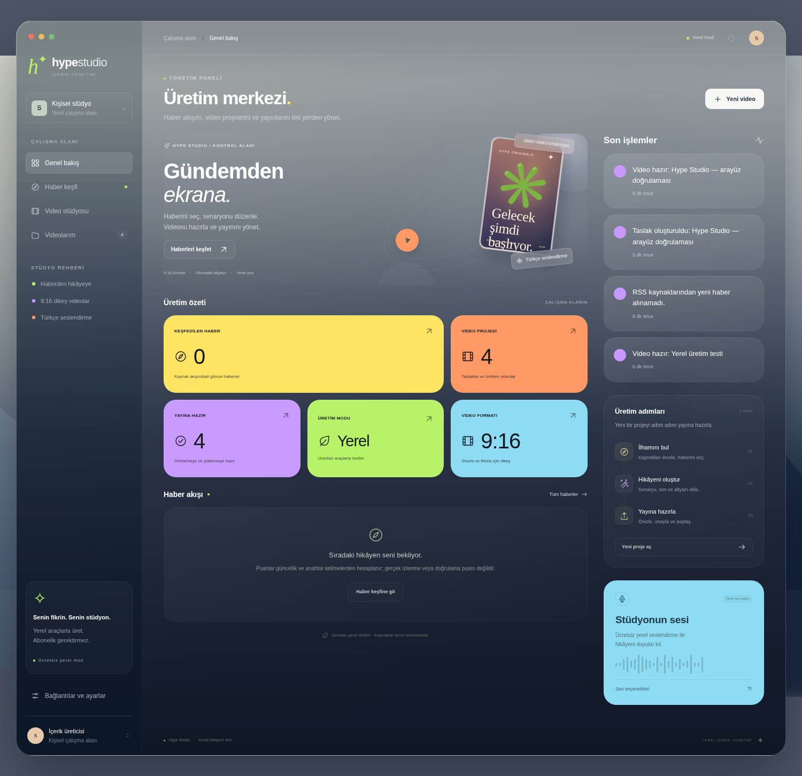
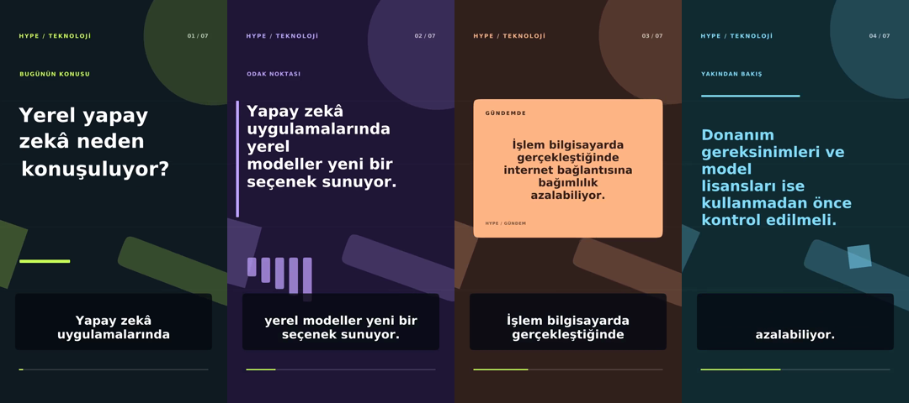

# Hype Studio

Teknoloji haberlerini bulup Türkçe kısa video projelerine dönüştüren, Mac için cam görünümünde bir üretim paneli. RSS haberlerinden konu seçin, senaryoyu ve başlığı düzenleyin, yerel seslendirme ve senkron altyazıyla 9:16 video oluşturun. Videoyu inceleyip indirin; isteğe bağlı YouTube bağlantısıyla kendi kanalınıza yükleyin.



Varsayılan üretim yolu API anahtarı ve ücretli abonelik istemez. RSS başlıkları ve kısa alıntıları kaynak bağlantısıyla taslak girdisi olarak alınır; video için uygulamanın ürettiği hareketli grafikler ve başlık kartları kullanılır. Başka yayınların videoları veya lisansı belirsiz stok görüntüler otomatik indirilmez. Haber sıralaması RSS içeriği ve güncellik üzerinden yapılır; tüm internetin gerçek zamanlı izlenmesi veya doğrulanmış trend ölçümü değildir. RSS erişimi, içeriği yeniden yayımlama lisansı vermez.

## Mac'te kurulum

Gerekenler: macOS, Python 3.11+, Node.js 22.12+, FFmpeg ve internet bağlantısı. Apple Silicon ve Intel cihazlarda ilgili araçların kendi mimarinize uygun sürümlerini kullanın. Homebrew zaten kuruluysa:

```bash
git clone https://github.com/a0pia/ytedit.git
cd ytedit
brew install python@3.12 node ffmpeg
HYPE_PYTHON="$(brew --prefix python@3.12)/bin/python3.12" ./scripts/setup.sh
npm start
```

`setup.sh` Python sanal ortamını oluşturur, Python ve kilitlenmiş Node bağımlılıklarını yükler, varsa mevcut `.env` dosyanızı korur. İlk kurulum paket indirmek için internet kullanır. Electron yerel Python sunucusunu başlatır ve ayrı bir masaüstü penceresi açar. Kuyrukta veya üretim/yükleme sırasında kapatırsanız onay ister; kendi başlattığı Python ve medya süreçlerini birlikte durdurur. Aynı proje, veri klasörü ve API sürümünü kullanan mevcut sunucuyu yeniden kullanabilir; başka sunucuları durdurmaz. Eski sunucu veya farklı veri klasörü aynı porttaysa açık bir hata verir.

Sonraki açılışlarda `scripts/Start-Hype-Studio.command` dosyasına çift tıklayabilirsiniz. Terminal'den `npm start` da kullanılabilir. Bu sürüm kaynak kodundan çalışan bir Mac masaüstü uygulamasıdır; Python ve FFmpeg içeren, imzalanmış/noter onaylı bir DMG paketi henüz hazırlanmış değildir.

Tarayıcıdan çalıştırmak için:

```bash
npm run dev
```

Ardından `http://127.0.0.1:8787` adresini açın. Sunucu yalnızca bu cihazın yerel arabirimini dinler. Başka cihazlara veya herkese açık internete açmak için tasarlanmamıştır. Electron görünümü macOS üzerinde, web arayüzü güncel tarayıcılarda kullanılabilir; bulut ortamında Mac pencere davranışı doğrulanamaz.

Linux geliştirme ortamında aynı komutlar kullanılabilir. FFmpeg yanında ücretsiz yerel seslendirme için `espeak-ng` gerekir (`sudo apt install ffmpeg espeak-ng`). Grafik ortamı bulunmayan bir sunucuda Electron yerine `npm run dev` kullanın.

Bu deponun Debian trixie/amd64 bulut makinesinde `./scripts/setup-cloud.sh` komutunu kullanın. Betik eSpeak'i Debian'ın imzalı paketlerinden `/workspace/.tools/espeak` altına açar; sistem paketlerini değiştirmez ve `sudo` istemez. Python, Node ve FFmpeg'in ortamda hazır bulunmasını bekler. Paket önbellekleri `/workspace/.cache/hype-studio` altında tutulur. Sonra `npm run dev` ile başlatın. Her bulut görevi zaten ayrı bir ortamda çalışır; mevcut checkout'u kullanın, ek Git worktree oluşturmayın.

Bulut ortamının ağ izin listesi varsa haber yenilemek için `shiftdelete.net`, `www.theverge.com`, `techcrunch.com` ve `feeds.arstechnica.com` alanlarına HTTPS erişimi gerekebilir. Ağ erişimi yoksa uygulama bunu bildirir; mevcut projeler ve elle girilen haberlerle yerel üretime devam edebilirsiniz.

## İlk video

1. Haberleri yenileyin ve bir teknoloji haberini seçin. Harici haberler için internet gerekir; kaynağı ve tarihi kontrol edin.
2. Kısa video projesi oluşturun. Üretilen senaryoyu, başlığı ve açıklamayı düzenleyin; iddiaları kaynaklardan doğrulayın.
3. Ücretsiz yerel seslendirmeyle videoyu oluşturun. FFmpeg özgün grafik arka planları, konuşma sesini ve senkron altyazıları tek MP4 dosyasında birleştirir.
4. Önizlemeyi izleyin. Türkçe telaffuz, altyazı zamanlaması ve haber doğruluğunu gözden geçirip dosyayı indirin.
5. YouTube hesabını isteğe bağlı bağlayın. Hazırladığınız videoyu onaylayıp yükleyin; yayın durumunu bilinçli seçin.

Video ayarlarında HD (720×1280), Full HD (1080×1920) ve QHD (1440×2560) boyutlarından birini; ayrıca 30 veya 60 FPS seçebilirsiniz. Varsayılan Full HD/60 FPS'tir. Yüksek ayarlar daha fazla işlem süresi ve disk alanı gerektirir.

Haber metinleri de telifli olabilir. Haberi kendi kısa anlatımınızla özetleyin, kaynağı belirtin ve yayımlamadan önce kullanılan içeriğin haklarını değerlendirin. YouTube'un özgünlük ve tekrar kullanılan içerik kuralları ayrıca geçerlidir.

## Ses ve dil modeli seçenekleri

| Seçenek | Maliyet ve gereksinim |
| --- | --- |
| Yerel senaryo şablonu | Varsayılan. API anahtarı ve model indirmesi gerekmez. Kaynak dilini korur; çeviri veya yaratıcı yeniden yazım yapmaz. Metni düzenleyebilir ya da Ollama seçebilirsiniz. |
| macOS `say` | Varsayılan ücretsiz seslendirme. Cihazda kurulu seslerden yararlanır. Türkçe ses yoksa Sistem Ayarları → Erişilebilirlik → Seslendirilen İçerik bölümünden Türkçe sesi indirin. |
| Linux eSpeak | Ücretsiz ve yerel. Ses kalitesi ticari servislerden daha basittir. |
| Hazır ses dosyası | MP3/WAV kaydını yükleyin. Uygulama ses API'si çağırmaz; kayıt için kullandığınız harici servisin kendi kotası ve koşulları geçerlidir. |
| Ollama | İsteğe bağlı, cihazda çalışan ücretsiz dil modeli. Model indirme, RAM ve disk gerekir. |
| ElevenLabs | İsteğe bağlı resmi API bağlantısı. Kendi anahtarınız ve ses kimliğiniz gerekir; ücretsiz kota ve ticari kullanım koşullarını sağlayıcı belirler. |
| OpenAI / Anthropic | İsteğe bağlı resmi API bağlantıları. Kendi API anahtarınız gerekir; kullanım ücretli olabilir. |

**ChatGPT Plus/Pro ve Claude Pro abonelikleri API kredisi sağlamaz.** Bu web aboneliklerini bağlayıp sınırsız veya ücretsiz API kullanımı sunmak mümkün değildir. Uygulama bu hesapların oturum çerezlerini almaz. Ücret istemiyorsanız varsayılan yerel üretimi veya Ollama'yı seçin; ücretli sağlayıcıları etkinleştirmeyin.

Ollama isterseniz resmi uygulamasını kurup modeli indirin:

```bash
ollama pull llama3.2:3b
```

Ollama çalışırken panelde yerel modeli seçin. Varsayılan servis adresi `http://127.0.0.1:11434`, model adı `llama3.2:3b`. İlk indirme birkaç GB disk kullanabilir. İşlemci/GPU hızına göre üretim süresi değişir. Ollama temel video üretimi için zorunlu değildir.

## ElevenLabs API'si olmadan kendi sesini kullan

1. Video editöründe Türkçe senaryoyu tamamlayın. Seslendirme metninin altındaki **Metni kopyala** veya **Metni indir** düğmesi güncel metni önce kaydeder.
2. Bu metni ElevenLabs web sitesinde veya başka bir ses aracında kendiniz seslendirin. Harici hesabın ücretsiz kota, indirme ve kullanım hakları o servise bağlıdır.
3. **Kendi ses dosyanı kullan** bölümünde hazırladığınız **MP3 veya WAV** dosyasını seçip **Sesi yükle** düğmesine basın. En fazla **25 MB ve 90 saniye**, en az 0,4 saniye; mono veya stereo kayıt desteklenir. Dosya cihazınızda işlenir.
4. Yüklemeden sonra **Yüklediğim ses dosyası** seçilir. Kaydı panelde dinleyin. **Altyazı zamanlarını düzenle** bölümünde gerekirse başlangıç/bitiş saniyelerini değiştirip kaydedin; bir altyazıya tıklayarak ilgili ses aralığını dinleyebilirsiniz.
5. **Videoyu oluştur** düğmesi animasyonlu sahneleri, altyazıları ve yüklediğiniz sesi birleştirir. Video uzunluğu kaydın süresine göre belirlenir. Önizleyip MP4 ve SRT dosyalarını indirin.

Otomatik altyazı zamanlaması sesin enerjisi, duraklamalar ve metin uzunluğundan **tahmin edilir**; konuşma tanıma veya kelime kelime doğrulanmış hizalama yapılmaz. Ses dosyası senaryoyla aynı metni içermelidir. Uzun bölümler, ayarladığınız zaman aralığı içinde en fazla iki satırlık altyazılara bölünür. Metni sonradan değiştirirseniz uygulama eski kaydı uyumsuz gösterir ve güncel metne uygun ses yüklemenizi ister. Başlık, açıklama veya etiketleri değiştirmek ses kaydını geçersiz kılmaz. Sesi değiştirdiğinizde video yeniden üretilir; hatalı bir yükleme önceki kaydı ve videoyu korur. Proje çoğaltma ve JSON dışa aktarma yalnızca metinleri taşır; ses dosyalarını taşımaz.

Bu akış için ElevenLabs API anahtarı, yerel ses motoru veya dil modeli gerekmez; FFmpeg gerekir. Tamamen ücretsiz kalmak için yerel seslendirmeyi veya kendi ücretsiz kaydınızı kullanabilirsiniz.

## YouTube bağlantısı

YouTube yüklemek için kendi Google Cloud OAuth istemciniz gerekir; bağlamadan MP4 üretip indirmeye devam edebilirsiniz.

1. Google Cloud Console'da bir proje oluşturup **YouTube Data API v3** hizmetini etkinleştirin.
2. OAuth izin ekranını yapılandırın. Uygulama test modundaysa Google hesabınızı test kullanıcısı ekleyin.
3. **Web application** türünde OAuth istemcisi oluşturun. Yetkili yönlendirme adresine tam olarak `http://127.0.0.1:8787/oauth/youtube/callback` ekleyin.
4. İstemci kimliği ve sırrını yerel `.env` dosyanıza girip uygulamayı yeniden başlatın. Google hesabınızın parolasını uygulamaya vermeyin.
5. Panelden YouTube'u bağlayın. İzin işlemi sistem tarayıcısında açılır ve yerel uygulamaya döner.

Port değiştirirseniz `.env` içindeki `YOUTUBE_REDIRECT_URI` değerini ve Google Cloud'daki yönlendirme adresini aynı portla güncelleyin. OAuth test uygulamalarında izinlerin süresi dolabilir; gerektiğinde yeniden bağlanın. YouTube API kotaları ve doğrulanmamış projelerin yükleme/yayın kısıtlamaları Google tarafından belirlenir. Bazı projelerde yüklemeler denetim tamamlanana kadar gizli videolarla sınırlı olabilir. Uygulama bu sınırlamaları aşmaz ve belirli bir günlük yükleme sayısı vaat etmez.

## Yerel ayarlar ve dosyalar

`.env.example` kullanılabilir değişkenleri gösterir. Anahtarları yerel `.env` dosyanızda saklayıp uygulamayı yeniden başlatın; bu dosyayı paylaşmayın. Örnek dosyada gerçek anahtar yoktur. API anahtarları ve YouTube yetkilendirmesi kendi cihazınızda saklanır; işletim sisteminde hesabınıza erişebilen kişilerden korumak sizin sorumluluğunuzdadır. Bu geliştirme sürümünde işletim sistemi Keychain entegrasyonu bulunmaz.

- `HYPE_PORT`: yerel sunucu portu, varsayılan `8787`.
- `HYPE_DATA_DIR`: proje, OAuth belirteci ve medya dosyaları klasörü. Terminal/web modunda varsayılan `data/`; Electron'da macOS uygulama verileri içindeki `Hype Studio/data` klasörü. Aynı verilere her iki moddan ulaşmak için iki başlangıçta da bu değişkeni aynı mutlak klasöre ayarlayın.
- `LOCAL_TTS_VOICE`: macOS için isteğe bağlı kurulu ses adı, örneğin `Yelda`.
- `OLLAMA_BASE_URL`, `OLLAMA_MODEL`: yerel dil modeli adresi ve modeli.
- `OPENAI_API_KEY`, `OPENAI_MODEL`, `ANTHROPIC_API_KEY`, `ANTHROPIC_MODEL`: isteğe bağlı dil modeli API'leri.
- `ELEVENLABS_API_KEY`, `ELEVENLABS_VOICE_ID`: isteğe bağlı seslendirme API'si.
- `YOUTUBE_CLIENT_ID`, `YOUTUBE_CLIENT_SECRET`, `YOUTUBE_REDIRECT_URI`: isteğe bağlı YouTube OAuth bilgileri.

Kurulumda belirli bir Python seçmek için `HYPE_PYTHON` değişkenini Python 3.11+ çalıştırılabilir dosyasının yoluna ayarlayın. Aksi halde kurulum uygun Python sürümünü ve Mac’te Homebrew yollarını otomatik arar. Electron sunucu için mevcut proje `.venv/bin/python` dosyasını öncelikli kullanır; bu yoksa `HYPE_PYTHON` yedek seçenektir. Sunucu günlüğü işletim sisteminin Electron günlük klasöründeki `hype-studio-backend.log` dosyasına yazılır.

## Geliştirme ve doğrulama

```bash
npm test
npm run check:desktop
npm run test:desktop
```

Python sunucusu `app/`, masaüstü başlatıcısı `desktop/`, kurulum komutları `scripts/` altındadır. İlk açılışta paketler indirilir; daha sonraki yerel video üretimi için ücretli API gerekmez. Haber yenileme, model indirme ve YouTube yükleme internet kullanır. Kullanılan açık kaynak araçların lisansları kendi projelerine aittir.

Video oluşturma zaman alabilir; uygulamayı işlem bitene kadar açık tutun. Aynı anda birden fazla ağır video üretimi, özellikle düşük bellekli cihazlarda, yavaşlığa yol açabilir. Mac kurulumu için hata alırsanız önce `ffmpeg -version`, `python3 --version` ve `node --version` çıktılarıyla önkoşulları kontrol edin. Anahtarları veya OAuth tokenlarını hata raporlarına eklemeyin.

İsteğe bağlı gerçek tarayıcı kontrolü için önce sunucuyu başlatın; ayrı bir geliştirme ortamına `playwright==1.55.0` kurup `CHROMIUM_PATH` ile Chromium çalıştırılabilir dosyasını belirtin. `.venv/bin/python tests/ui_smoke.py` manuel taslak oluşturur, ücretsiz sesli video üretir, videonun 1080×1920 olarak çözüldüğünü, SRT'yi ve yükleme onayını kontrol eder. Gerçek YouTube yüklemesi yapmaz. Başarılı çıktılar `artifacts/` altına ekran görüntüsü olarak kaydedilir.

Bu geliştirme ortamında 243 Python testi ve 9 masaüstü yaşam döngüsü testi geçti. Gerçek tarayıcıda ücretsiz sesli video üretimi, metadata düzenleme, taslak koruması, proje arama/çoğaltma/dışa aktarma/silme ve 15 ekran/boyut kombinasyonu doğrulandı. Canlı RSS erişimi bulut proxy politikası nedeniyle engellendi; Google hesabı verilmediğinden gerçek YouTube yüklemesi ve API anahtarı gerektiren servisler çalıştırılmadı. Mac masaüstü başlatıcısının sözdizimi kontrol edildi; macOS üzerinde çalışma testi henüz yapılmadı.

## 0.2 sürümündeki iyileştirmeler

- Mac penceresine sığan, içeride kaydırılan yönetim paneli; daha okunaklı yazılar ve kısa ekranlarda erişilebilir yan menü.
- Projelerde arama ve durum filtresi; çoğaltma, JSON dışa aktarma ve onaylı silme. İşlenen projeler düzenlenemez veya silinemez.
- Kaydedilmemiş değişiklikler için gezinme uyarısı. Açıklama/etiket düzenlemek mevcut videoyu korur; başlık veya seslendirme metni değişirse video yeniden üretilmelidir.
- Tüm aktif işlerin takibi ve gerçek video kodlama ilerlemesi. Kapanışta kesilen işler sonraki açılışta açık hata durumuyla gösterilir.
- Haber kaynaklarının ayrı sağlık durumları ve son tarama zamanı. Kısmi erişim hatalarında diğer kaynakların yedi günden yeni önbelleği korunur; takip parametreleriyle yinelenen bağlantılar ayıklanır. Puanlar hâlâ yaklaşık editoryal sıralamadır.
- Eksik FFmpeg bileşeni ve ses kurulumu erken bildirilir. Türkçe kısaltmalarda daha doğal cümle bölme, uzun başlıkları sığdırma ve başarısız üretim dosyalarını temizleme.
- Sonucu belirsiz YouTube yüklemesi için kanalı kontrol ettiğinize dair ayrı tekrar deneme onayı. Aynı hesabın eşzamanlı yüklemeleri erişim belirtecini güvenli biçimde paylaşır.

Mevcut kurulumunuzu güncellemek için uygulamayı kapatın, proje klasöründe `git pull origin main` ve `./scripts/setup.sh` çalıştırıp `npm start` ile yeniden açın. Eski yerel sunucu arka planda açıksa önce onu durdurun. Yerel `.env`, projeler ve videolar korunur.

## Türkçe haber ve video çevirisi

Yabancı bir haberden video üretirken **Türkçe video hazırla** akışını kullanın. Orijinal başlık/özet ile Türkçe karşılığı birlikte gösterilir. Çeviriyi düzenleyip Türkçe taslak oluşturduğunuzda seslendirme ve altyazı aynı Türkçe metinden üretilir. Kaynak bağlantısı korunur. Mevcut bir videonun editöründeki **Metinleri Türkçeye çevir** işlemi başlık, senaryo, açıklama ve etiketleri birlikte çevirir; başarılı çeviriden sonra videoyu yeniden üretin. Başarısız çeviri mevcut metni veya videoyu silmez. YouTube’a daha önce yüklenmiş bir projeyi çevirmek için önce çoğaltın; yayımlanan sürüm korunur.

Ücretsiz çeviri için Mac'te Ollama ve model gerekir. Homebrew kuruluysa:

```bash
brew install ollama
brew services start ollama
ollama pull llama3.2:3b
```

Alternatif olarak Ollama'nın resmi Mac uygulamasını kurup çalıştırabilir, ardından modeli indirebilirsiniz. Model ilk indirmede birkaç GB disk ve internet kullanır; sonraki yerel çeviriler API ücreti gerektirmez. Panelde bağlantıları yenileyin. Farklı model için `.env` içinde `OLLAMA_MODEL` ayarlayıp Hype Studio'yu yeniden başlatın.

Şablon modu tek başına çeviri yapmaz. Ollama erişilemiyorsa uygulama bunu gösterir; ücretli sağlayıcıya kendiliğinden geçmez. OpenAI/Anthropic API'leri yalnızca sizin açık seçiminiz ve API anahtarınızla kullanılabilir. Çeviri bir taslaktır; rakamları, özel adları ve iddiaları orijinal haberle karşılaştırın. RSS erişimi haber metninin yeniden yayım hakkını otomatik sağlamaz.

## Animasyonlu kısa videolar

Varsayılan **Animasyonlu sahneler** tasarımı, ilk saniyelerde hareketli büyük bir giriş başlığıyla başlar. Ardından senaryodan alınan cümleler farklı renklerde, değişen yerleşimlerde ve hareketli grafiklerle gösterilir. Altyazılar seslendirmeye göre zamanlanır. Vurgu kartları senaryodaki ifadeleri kullanır; rastgele rakam veya haber iddiası üretilmez. İsterseniz **Klasik** tasarımı seçebilirsiniz.

Bütün grafikler uygulama içinde üretilir. Bu özellik ücretli stok video, müzik veya görsel API'si kullanmaz; şimdilik dış video kliplerinin otomatik montajı değildir.



[Gerçek animasyonlu örnek MP4](docs/animated-example.mp4)

`tests/translation_ui_smoke.py`, ayrı bir yerel ve belirli yanıt veren model taklidiyle gerçek HTTP çeviri bağlantısını ve arayüzü doğrular. Bu, gerçek bir dil modelinin çeviri kalitesi testi değildir. Bulut makinesinde Ollama model indirme adresleri proxy403 ile engellendiği için gerçek model çalıştırılmadı; gerçek animasyonlu video ve Türkçe yerel seslendirme ise FFmpeg ile üretildi.

## 0.4: Hazır ses dosyasıyla kurgu

- Kaydedilmiş güncel senaryoyu panoya kopyalama ve UTF-8 TXT indirme.
- Yerel MP3/WAV yükleme, ses önizlemesi, güvenli değiştirme ve kaldırma.
- Yüklenen kaydın süresine göre animasyonlu veya klasik video; seslendirme API'si çağrılmaz.
- Tahmini altyazı zamanları ve elle düzeltme; metin değiştiğinde eski sesle üretimin engellenmesi.
- Ayrı ses yükleme limiti; diğer API isteklerinin 64 KiB sınırı korunur. İşleme sırasında proje düzenleme/silme kilidi ve masaüstü çıkış uyarısı.

`HYPE_BROWSER_NO_SANDBOX=1 .venv/bin/python tests/audio_ui_smoke.py` gerçek Türkçe yerel kaydı arayüzden yükleyerek TXT indirme, ses önizleme, zaman düzeltme ve gerçek animasyonlu MP4/SRT üretimini kontrol eder. ElevenLabs web sitesine veya API'sine bağlanmaz.
